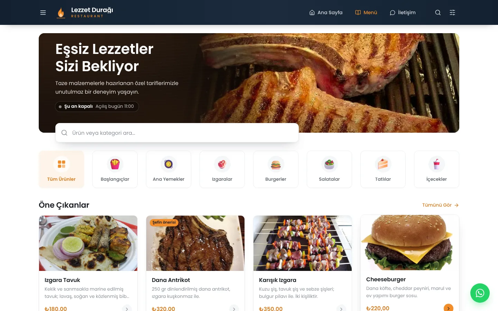
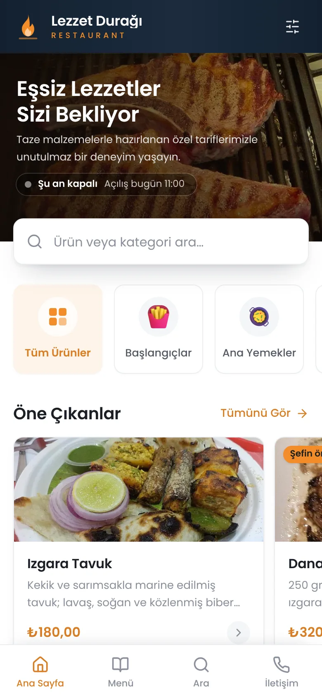
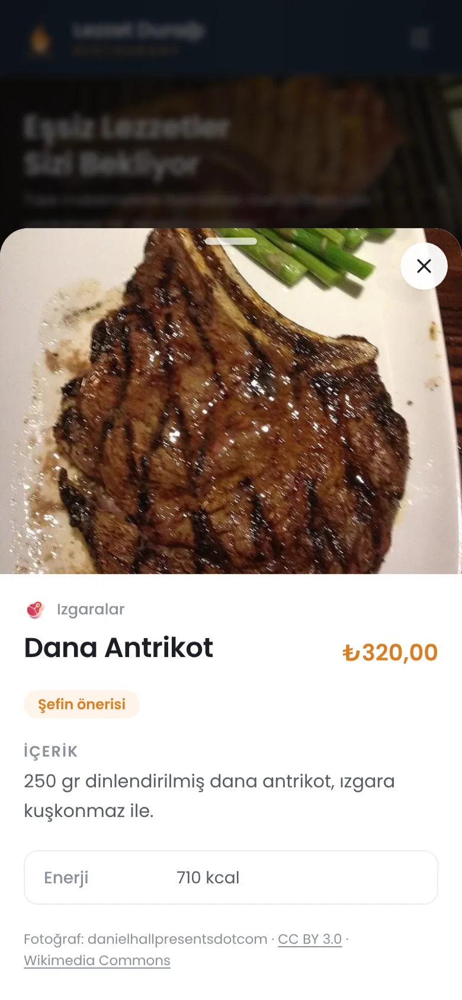
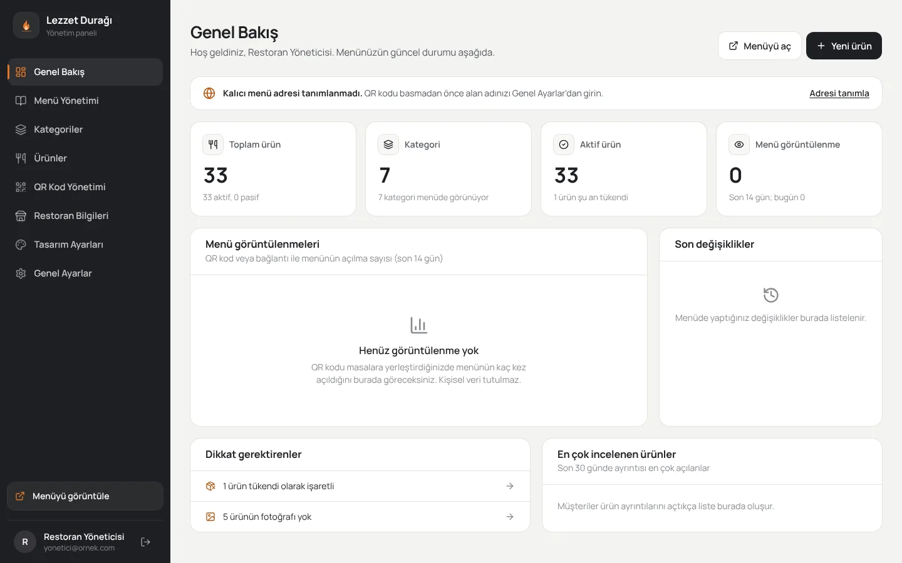
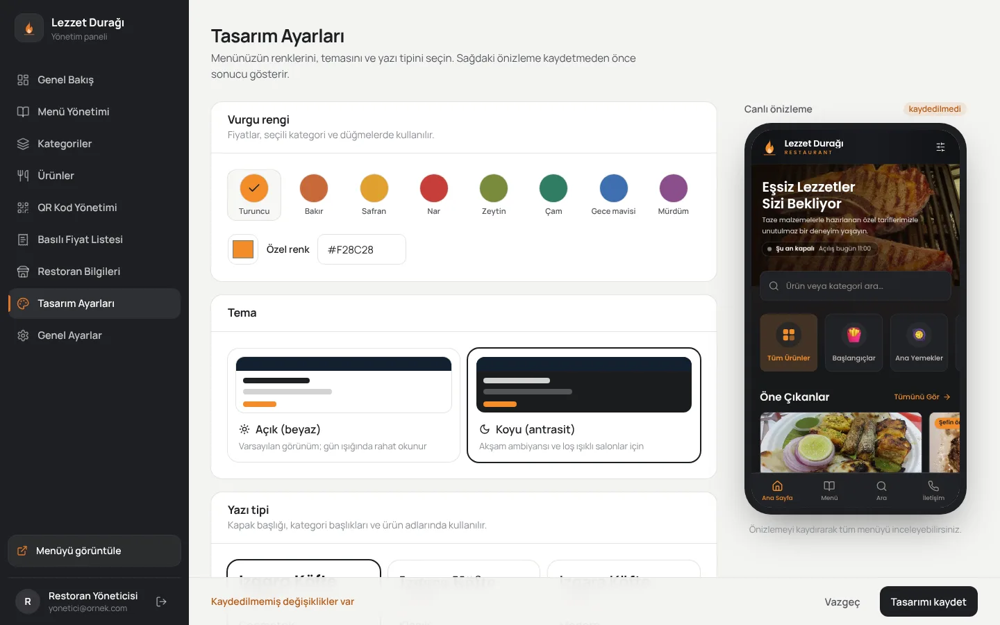
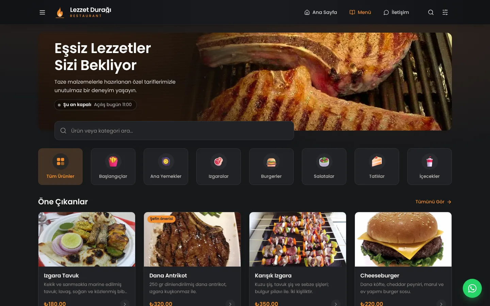

# EKİP1 Dijital Menü

Tek bir restorana özel, QR kodla açılan dijital menü ve yönetim paneli.
Müşteri QR kodu okuttuğunda doğrudan menü açılır; restoran sahibi menüyü, fiyatları, fotoğrafları
ve tasarımı yönetim panelinden günceller, değişiklik anında yayına girer.

> **Bu bir menü sistemidir, online sipariş sistemi değildir.** Sepet, "sepete ekle", adet seçici,
> sipariş oluşturma veya ödeme ekranı **yoktur**. Ürün detayında yalnızca fotoğraf, ad, fiyat,
> açıklama (içerik) ve varsa alerjen/enerji bilgisi gösterilir.

| Masaüstü | Telefon | Ürün detayı |
|---|---|---|
|  |  |  |

| Yönetim paneli | Tasarım ayarları (canlı önizleme) | Koyu tema |
|---|---|---|
|  |  |  |

## Neler gerçek, neler değil?

Uygulamadaki her işlev gerçek bir sunucu ve veritabanı ile çalışır; sahte/örnek davranış yoktur.

| Özellik | Durum |
|---|---|
| Veritabanı | **Gerçek, kalıcı.** SQLite (Node.js yerleşik `node:sqlite`, WAL modu) — `data/menu.db`. Şema sürümlü geçişlerle (migration) güncellenir. |
| Yönetici girişi | **Gerçek.** scrypt şifre özeti, sunucu tarafı oturumlar (çerezde yalnızca rastgele belirteç; veritabanında SHA-256 özeti), CSRF koruması, giriş deneme sınırı. |
| Görsel yükleme | **Gerçek.** sharp ile doğrulanır, döndürülür, EXIF/GPS silinir, 3 boyutta WebP üretilir ve veritabanında saklanır. |
| QR kod | **Gerçek.** Kalıcı menü adresinden üretilir; PNG (512/1024/2048 px) ve SVG indirilir. Testlerde indirilen QR çözülerek adres doğrulanır. |
| Tasarım ayarları | **Gerçek.** Vurgu rengi, açık/koyu tema, yazı tipi; kaydetmeden önce canlı önizleme. |
| Ziyaret istatistikleri | **Gerçek, anonim.** Menü ve ürün görüntülenme sayıları (çerez/IP saklanmaz). |
| Online sipariş / ödeme | **Yok — bilinçli olarak.** Bu ürün yalnızca menüdür. |
| Çoklu restoran / SaaS | **Yok — bilinçli olarak.** Tek restoran için kurulur. |

Gizli bilgiler (şifre özetleri, oturumlar) yalnızca sunucuda tutulur; tarayıcıya hiçbir gizli anahtar gönderilmez.

## Müşteri menüsü

Tasarım, verilen referans görsele göre birebir uygulanmıştır:

- Lacivert üst bar: logo + "RESTAURANT" alt yazısı, Ana Sayfa · Menü · İletişim, arama ve filtre düğmeleri
- Kapak: koyu, sıcak ahşap zemin üzerinde yemek fotoğrafı, büyük beyaz başlık, kısa açıklama ve
  **anlık çalışma durumu** ("Şu an açık · Kapanış 23:00")
- Kapağın altına taşan geniş arama kutusu (Türkçe karakterden bağımsız arar: "sogan" → "Soğan")
- Yatay kategori sekmeleri: renkli 3B ikonlar, seçili sekme turuncu tonlu; "Tüm Ürünler" ilk sırada.
  Sekme menüyü filtreler ve adrese yazılır (`/menu?kategori=izgaralar`), bağlantı paylaşılabilir.
- **Öne Çıkanlar**: üstte büyük yemek fotoğrafı, altında ad, açıklama, turuncu fiyat ve ok; "Tümünü Gör"
- Ürün detayı: büyük fotoğraf, kategori, ad, fiyat, **İçerik**, alerjenler ve enerji, fotoğraf kaynağı.
  Telefonda alttan açılan sayfa (aşağı kaydırarak kapanır), masaüstünde ortalanmış pencere.
  Her ürünün paylaşılabilir bağlantısı vardır (`/menu?urun=izgara-tavuk`); sunucuda açık olarak işlenir.
- Fotoğrafı olmayan ürünlerde gri kutu yoktur: ürün adına uygun renkli ikon (kahve, çay, ayran…) ile
  kompakt satır kartı gösterilir.
- Telefonda alt gezinme çubuğu: **Ana Sayfa · Menü · Ara · İletişim** (referanstaki "Sepet" kaldırıldı)
- Masaüstünde sağ altta WhatsApp düğmesi (yalnızca iletişim için)
- Etiket filtreleri (vegan, glutensiz, acılı…), "tükenenleri gizle", tükendi rozetleri
- İletişim ve çalışma saatleri bölümü, bugünün vurgulandığı haftalık saat tablosu
- Alt bilgide **Gizlilik ve çerezler** bağlantısı (KVKK aydınlatma metni)
- Erişilebilirlik: klavye ile gezinme, ekran okuyucu etiketleri, `prefers-reduced-motion` desteği

**Tema:** Referans görsel beyaz içerik alanlı olduğu için varsayılan tema **Açık (beyaz)**'tır.
Antrasit zeminli, sıcak ışıltılı ve koyu arama kutulu **Koyu** tema, Yönetim → Tasarım Ayarları'ndan tek tıkla seçilebilir.

## Yönetim paneli

`/yonetim` adresinden giriş yapılır.

- **Genel Bakış** — ürün/kategori sayıları, son 14 günün menü görüntülenmeleri, en çok bakılan ürünler, son işlemler
- **Menü Yönetimi** — kategoriler ve ürünler tek ekranda; sürükleyerek sıralama, fiyatı yerinde düzenleme, tükendi/menüde göster anahtarları
- **Kategoriler** — ekleme, düzenleme, ikon seçimi, gizleme, silme (ürünleri başka kategoriye taşıyarak veya silerek)
- **Ürünler** — arama ve filtreler, fotoğraf yükleme (sürükle-bırak), etiketler, alerjen, kalori, menüdeki kartın canlı önizlemesi
- **QR Kod Yönetimi** — menü bağlantısı, PNG/SVG indirme, yazdırılabilir masa kartı
- **Basılı Fiyat Listesi** — menüdeki tüm ürünler güncel fiyat, açıklama ve alerjen bilgisiyle A4 olarak yazdırılır veya PDF kaydedilir
- **Restoran Bilgileri** — ad, logo alt yazısı, kapak başlığı ve açıklaması, logo, kapak fotoğrafı, iletişim, çalışma saatleri
- **Tasarım Ayarları** — vurgu rengi (okunabilirlik otomatik denetlenir), tema, yazı tipi, bölümleri aç/kapat; kaydetmeden canlı önizleme
- **Genel Ayarlar** — site adresi (QR kod bu adrese göre üretilir), saat dilimi, SEO, menüyü yayından kaldırma, gizlilik ve çerez metni, hesap ve şifre, tüm oturumları kapatma, veritabanı yedeği indirme

## Kurulum

Gereksinim: **Node.js 22.13 veya üzeri** (ek veritabanı sunucusu gerekmez).

```bash
npm install
cp .env.example .env          # ADMIN_EMAIL / ADMIN_PASSWORD değerlerini düzenleyin
npm run build
npm run seed                  # yönetici hesabı + fotoğraflı örnek menü
npm start                     # http://localhost:3000/menu
```

- `npm run seed` hiç yönetici yoksa `.env`'deki `ADMIN_EMAIL` / `ADMIN_PASSWORD` ile hesap oluşturur
  (şifre boşsa güçlü bir şifre üretip ekrana yazar). Menü boşsa örnek "Lezzet Durağı" menüsünü yükler.
- `npm run seed -- --sifirla` mevcut menüyü silip örnek menüyü yeniden yükler; `--fotografsiz` fotoğrafsız yükler;
  `--fotograflar ./klasor` kendi fotoğraflarınızı (dosya adı = ürün kısa adı, ör. `izgara-tavuk.jpg`) ürünlere bağlar.
- Geliştirme: `npm run dev` (dosya değiştikçe yeniden derler ve sunucuyu yeniden başlatır).

### Yönetici hesapları

```bash
npm run admin -- liste
npm run admin -- olustur eposta@ornek.com "Ad Soyad"
npm run admin -- sifre eposta@ornek.com
npm run admin -- sil eposta@ornek.com      # son yönetici silinemez
```

## Yayına alma

- **Docker:** `docker compose up -d --build`, ardından ilk kurulum için
  `docker compose exec -e ADMIN_PASSWORD='...' menu npm run seed`. Veriler `menu-veri` biriminde kalıcıdır.
- **Sunucuya doğrudan:** `deploy/dijital-menu.service` (systemd) ve `deploy/nginx.conf` veya `deploy/Caddyfile` örnekleri.
  HTTPS ters vekil arkasında `TRUST_PROXY=true` yapın.
- QR kodu basmadan önce **Genel Ayarlar → Site adresi** alanına kalıcı alan adınızı yazın (ör. `https://lezzetduragi.com`).
  QR kod yalnızca `/menu` adresini içerir; menü değiştikçe QR kodu yeniden basmanız gerekmez.
- **Yedekleme:** yedeklenmesi gereken tek klasör `data/`'dır (veritabanı ve tüm görseller). Panelden de anlık yedek indirilebilir.

Ortam değişkenlerinin tamamı `.env.example` dosyasında açıklanmıştır.

### Tek dosyalık HTML önizleme

Menüyü sunucu olmadan incelemek veya müşteriye göndermek için, sunucu açıkken:

```bash
npm run onizleme                      # dist/menu-onizleme.html
npm run onizleme -- --koyu            # koyu tema: dist/menu-onizleme-koyu.html
npm run onizleme -- --adres http://localhost:3000 --cikti ./menu.html
```

Dosya; menü verilerini, fotoğrafları, ikonları, yazı tiplerini ve menü kodunun aynısını içerir. İnternetsiz açılır;
kategori sekmeleri, arama, filtre ve ürün detayı çalışır. Yalnızca o anki menünün kopyasıdır — panelde yapılan
değişiklikler için dosyayı yeniden üretin.

## Testler

```bash
npm run typecheck
npm test                      # birim + entegrasyon testleri (54 test)
npm run build && npm run test:e2e            # gerçek tarayıcıda uçtan uca testler (18 senaryo)
npm run test:e2e -- --ekran                  # docs/ekran-goruntuleri altındaki görüntüleri yeniler
```

Kapsam: fiyat/saat/renk yardımcıları, doğrulama şemaları, şifre özeti, giriş kilidi, CSRF ve çerez güvenliği,
XSS kaçışı, görsel işleme ve EXIF silme, QR kodun çözülerek doğrulanması, menü API'si, SSR menü,
paylaşılan ürün/kategori bağlantıları, yönetici önizlemesi, menüyü yayından kaldırma; tarayıcıda kategori
sekmeleri, arama, filtre, ürün detayı, telefon gezinmesi ve yatay taşma kontrolü, menüde sepet/sipariş öğesi
bulunmadığı, panelden fotoğraflı ürün ekleme, QR PNG indirme ve tema değiştirme.

## Yasal uyumluluk notları

> Bu bölüm bilgilendirme amaçlıdır, hukuki görüş değildir. Kendi durumunuz için bir avukata danışın.

**Çerezler ve KVKK.** Müşteri menüsü hiç çerez yazmaz; reklam, izleme veya analiz aracı, harici yazı tipi
ya da sosyal medya eklentisi yüklemez (tüm dosyalar kendi sunucunuzdan gelir). Görüntülenme sayısı kimliksiz
tutulur. Onay alınması gereken bir çerez olmadığı için **çerez onay penceresi gerekmez** — gereksiz bir onay
penceresi göstermek de önerilmez. Yönetim panelindeki `menu_oturum` çerezi yalnızca giriş için zorunlu çerezdir
(HttpOnly, SameSite=Lax, yalnızca `/yonetim` yolunda). Sunucu ve ters vekil (Nginx/Caddy) teknik kayıtlarda IP
adresi tutabileceği için menünün alt bilgisinde **Gizlilik ve çerezler** metni (KVKK aydınlatma metni) bulunur.
Varsayılan metin restoran bilgilerinizden oluşturulur; Yönetim → Genel Ayarlar'dan kendi metninizle değiştirebilirsiniz.

**Fiyat Etiketi Yönetmeliği** (11 Ekim 2025 değişikliği). Masalarda fiyat listesi karekodla (QR) sunulabilir; ancak
müşteri isterse fiyat listesi **basılı olarak** verilmeli ve işyeri **girişinde** görülebilir bir fiyat listesi
bulunmalıdır. Bunun için Yönetim → **Basılı Fiyat Listesi** sayfasından A4 liste yazdırın. Servis ücreti, kuver gibi
fiyata ek her türlü ücret fiyat listesinde gösterilmelidir: Restoran Bilgileri → **Fiyat bilgisi notu** alanına yazın;
menüde ve basılı listede görünür. Bakanlığın belirleyeceği ölçütlere giren işletmeler fiyat listelerini ayrıca
Bakanlığın elektronik sistemine aktarmakla yükümlüdür (bu sistem bu yazılıma bağlı değildir).

**Alerjenler** (Türk Gıda Kodeksi Gıda Etiketleme ve Tüketicileri Bilgilendirme Yönetmeliği). Toplu tüketim
yerlerinde alerjen içeren ürünler menüde belirtilmelidir. Her ürünün **Alerjenler** alanını doldurun; bilgi ürün
detayında ve basılı fiyat listesinde gösterilir.

## Proje yapısı

```
src/
  shared/        istemci + sunucu ortak: türler, doğrulama şemaları, biçimlendirme, saatler, renkler, katalog
  server/        HTTP yönlendirme, güvenlik, veritabanı + geçişler, depolar, görsel/QR servisleri, SSR
  client/menu/   müşteri menüsü (React, sunucuda işlenir + tarayıcıda hydrate)
  client/admin/  yönetim paneli (React, istemci tarafı yönlendirme)
  styles/        Tailwind CSS 4 tema belirteçleri ve bileşen stilleri
scripts/         derleme, geliştirme sunucusu, örnek veri yükleme, yönetici komutları
public/          yazı tipleri ve kategori ikonları
ornek-veriler/   örnek menü fotoğrafları ve lisans bilgileri
tests/           birim, entegrasyon ve tarayıcı testleri
deploy/          systemd, Nginx ve Caddy örnekleri
```

## Lisanslar ve fotoğraf kaynakları

Örnek menüdeki yemek fotoğrafları Wikimedia Commons'tan özgür lisanslarla (CC0, CC BY, CC BY-SA, kamu malı)
alınmıştır; fotoğrafçı ve lisans bilgisi menüde her ürünün detayında ve alt bilgideki **Fotoğraf kaynakları**
bağlantısında gösterilir. Kendi fotoğraflarınızı yüklediğinizde bu bilgi görünmez. Kategori ikonları Microsoft
Fluent Emoji (MIT), yazı tipleri SIL OFL lisanslıdır. Ayrıntılı liste: [THIRD_PARTY_NOTICES.md](THIRD_PARTY_NOTICES.md).
